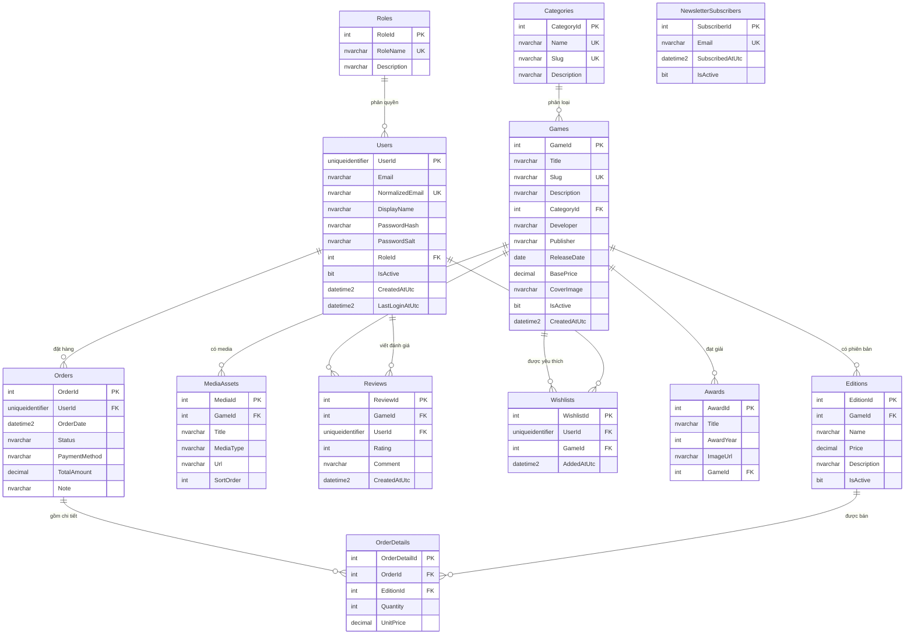

# Sơ đồ quan hệ thực thể (ERD)

Cơ sở dữ liệu `WukongStudy` gồm **12 bảng**, được ánh xạ bằng Entity Framework 6 theo hướng **Database First** (tệp `Models/WukongModel.edmx`). Sơ đồ dưới đây dùng cú pháp Mermaid nên hiển thị trực tiếp trên GitHub, VS Code hoặc công cụ xem Markdown có hỗ trợ Mermaid.



## Quan hệ và khóa ngoại

| Quan hệ | Kiểu | Khóa ngoại | Xóa |
| --- | --- | --- | --- |
| `Roles` → `Users` | 1-n | `Users.RoleId` | Restrict |
| `Categories` → `Games` | 1-n | `Games.CategoryId` | Restrict |
| `Games` → `Editions` | 1-n | `Editions.GameId` | Cascade |
| `Games` → `MediaAssets` | 1-n | `MediaAssets.GameId` | Cascade |
| `Games` → `Reviews` | 1-n | `Reviews.GameId` | Cascade |
| `Games` → `Wishlists` | 1-n | `Wishlists.GameId` | Cascade |
| `Games` → `Awards` | 1-n (cho phép null) | `Awards.GameId` | Set null |
| `Users` → `Orders` | 1-n | `Orders.UserId` | Restrict |
| `Users` → `Reviews` | 1-n | `Reviews.UserId` | Cascade |
| `Users` → `Wishlists` | 1-n | `Wishlists.UserId` | Cascade |
| `Orders` → `OrderDetails` | 1-n | `OrderDetails.OrderId` | Cascade |
| `Editions` → `OrderDetails` | 1-n | `OrderDetails.EditionId` | Restrict |

`Wishlists` đóng vai trò bảng nối nhiều-nhiều giữa `Users` và `Games`. `OrderDetails` là bảng nối có thuộc tính riêng (`Quantity`, `UnitPrice`) giữa `Orders` và `Editions`.

## Ràng buộc nghiệp vụ đáng chú ý

- `Users.NormalizedEmail` là duy nhất; email được chuẩn hóa về chữ thường trước khi lưu và tra cứu.
- `Reviews` có khóa duy nhất `(GameId, UserId)`: mỗi người chỉ có một đánh giá cho mỗi game, lần gửi sau cập nhật đánh giá cũ.
- `Wishlists` có khóa duy nhất `(UserId, GameId)`: không thể yêu thích trùng.
- `OrderDetails` có khóa duy nhất `(OrderId, EditionId)` và `Quantity > 0`.
- `Orders.Status` chỉ nhận `Pending`, `Paid`, `Cancelled`, `Refunded`.
- `Reviews.Rating` nằm trong khoảng 1–5; `Games.BasePrice` và `Editions.Price` không âm.
- `Games.Slug`, `Categories.Slug`, `Categories.Name` và `NewsletterSubscribers.Email` là duy nhất.

## Ánh xạ sang Entity Framework 6

- `Models/WukongModel.edmx` chứa CSDL (khái niệm), SSDL (lưu trữ) và MSL (ánh xạ). Khi build, MSBuild nhúng ba tệp này vào `WukongWeb.dll` dưới dạng tài nguyên.
- Chuỗi kết nối trong `Web.config` dùng `metadata=res://*/Models.WukongModel.csdl|...` nên ứng dụng không phụ thuộc đường dẫn vật lý của tệp EDMX.
- `WukongEntities : ObjectContext` sinh ra các `ObjectSet<T>` như `Db.Games`, `Db.Users`, `Db.Orders`. Các thực thể kế thừa `EntityObject` và quan hệ được biểu diễn bằng `EntityReference<T>` / `EntityCollection<T>`.
- Truy vấn dùng LINQ to Entities (`Where`, `OrderBy`, `GroupBy`, `Sum`, `Any`, `Select`, `Skip/Take`) và chỉ gọi `ToList()` khi dữ liệu đã được lọc/sắp xếp, nhờ đó SQL Server thực thi phép lọc thay vì tải toàn bộ bảng.

## Truy vấn LINQ tiêu biểu

```csharp
// Lọc, sắp xếp và phân trang catalogue (GamesController.Index)
var query = Db.Games.Where(g => g.IsActive);
if (!string.IsNullOrWhiteSpace(q))
{
    var term = q.Trim();
    query = query.Where(g => g.Title.Contains(term) || g.Description.Contains(term));
}
var total = query.Count();
var items = query.OrderBy(g => g.Title)
                 .Skip((page - 1) * PageSize)
                 .Take(PageSize)
                 .ToList();
```

```csharp
// Tổng hợp doanh thu theo game cho dashboard (AdminController.Index)
var top = Db.OrderDetails
    .GroupBy(d => d.Edition.GameId)
    .Select(g => new
    {
        GameId = g.Key,
        UnitsSold = g.Sum(x => x.Quantity),
        Revenue = g.Sum(x => x.Quantity * x.UnitPrice)
    })
    .OrderByDescending(g => g.UnitsSold)
    .Take(5)
    .ToList();
```

```csharp
// Điểm trung bình và số đánh giá (GamesController.Details)
AverageRating = Db.Reviews.Where(r => r.GameId == id)
                          .Average(r => (int?)r.Rating),
ReviewCount  = Db.Reviews.Count(r => r.GameId == id),
```

## Ghi chú thiết kế

- Giá của đơn hàng được đọc từ `Editions.Price` trên máy chủ, không lấy từ trình duyệt, nên người dùng không thể sửa giá bằng công cụ dev.
- Mỗi dòng trong `Editions` là một sản phẩm bán được: trang chi tiết game đưa `editionId` sang `Checkout`, và `CheckoutController.ResolveSelection` kiểm tra lại edition + game còn `IsActive` trước khi tạo đơn. Nhờ vậy `Editions` có vai trò nghiệp vụ thật, không phải bảng trang trí.
- Đơn hàng được tạo trong `TransactionScope`: `Orders` và `OrderDetails` cùng thành công hoặc cùng hủy.
- Xóa game/người dùng đã phát sinh giao dịch sẽ **ngừng kích hoạt** thay vì xóa cứng, để bảo toàn lịch sử bán hàng; đây là quy tắc nghiệp vụ được cài trong `AdminController`.
- `NewsletterSubscribers` được ghi từ form *Subscribe now* ở footer landing page (`HomeController.Subscribe`): email chuẩn hóa về chữ thường, đăng ký lại thì bật `IsActive` thay vì tạo bản ghi trùng. Admin xem danh sách mới nhất trên dashboard.
